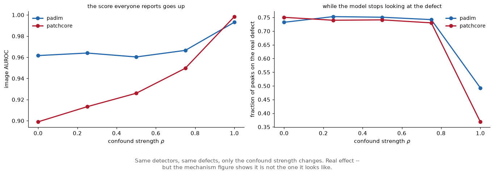
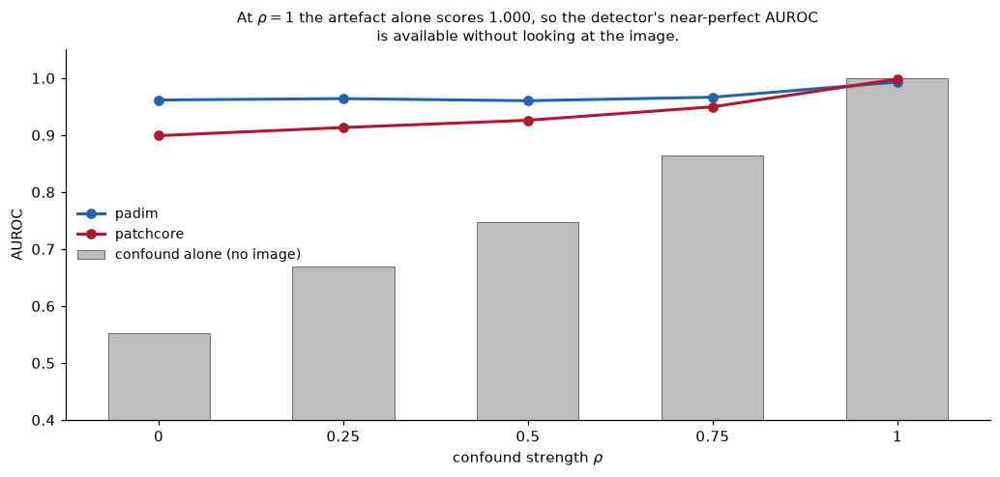
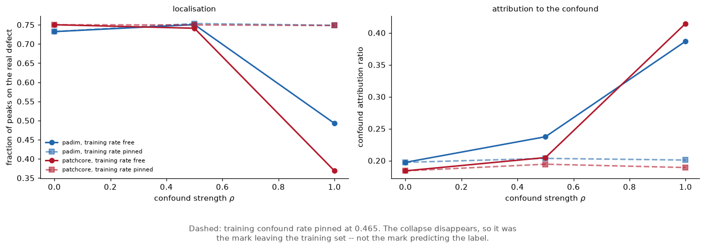
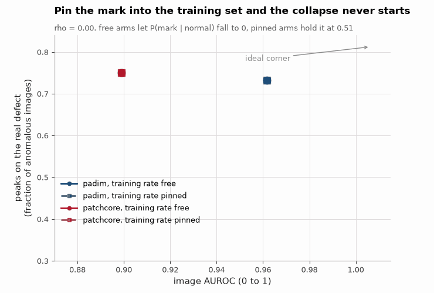
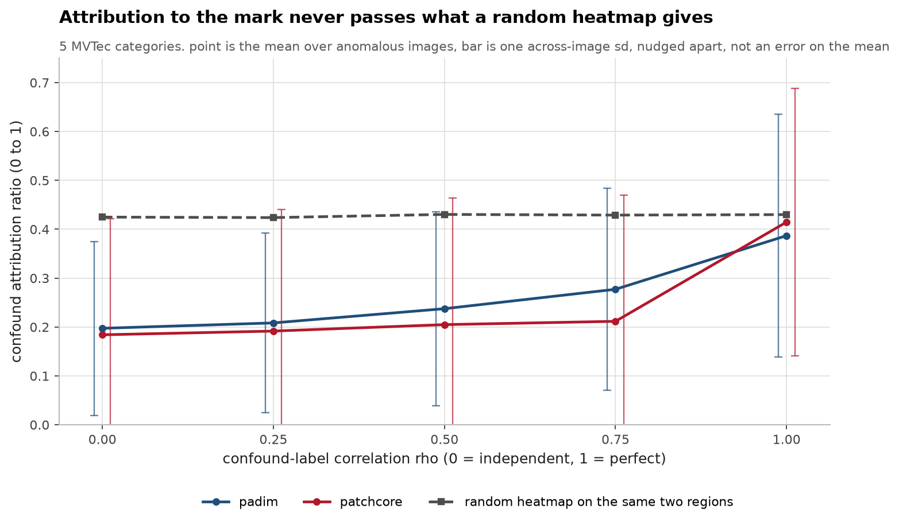
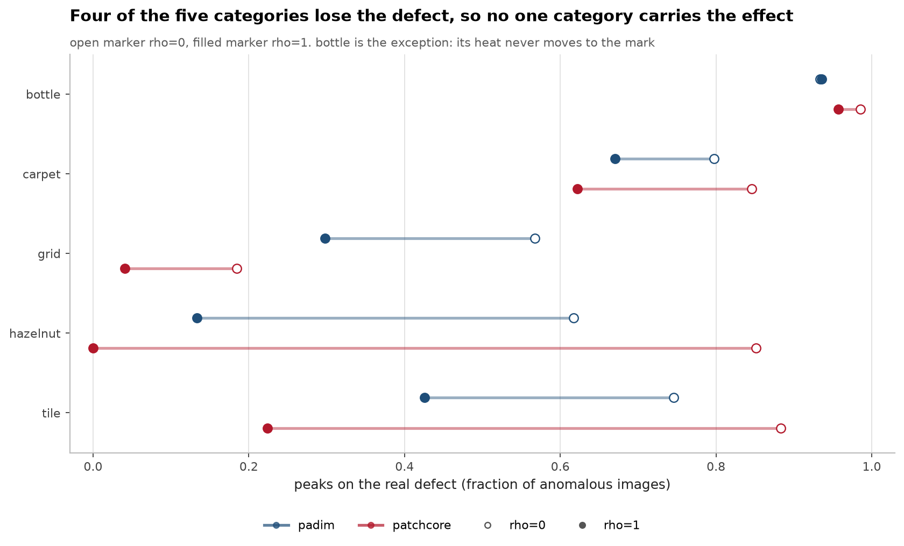
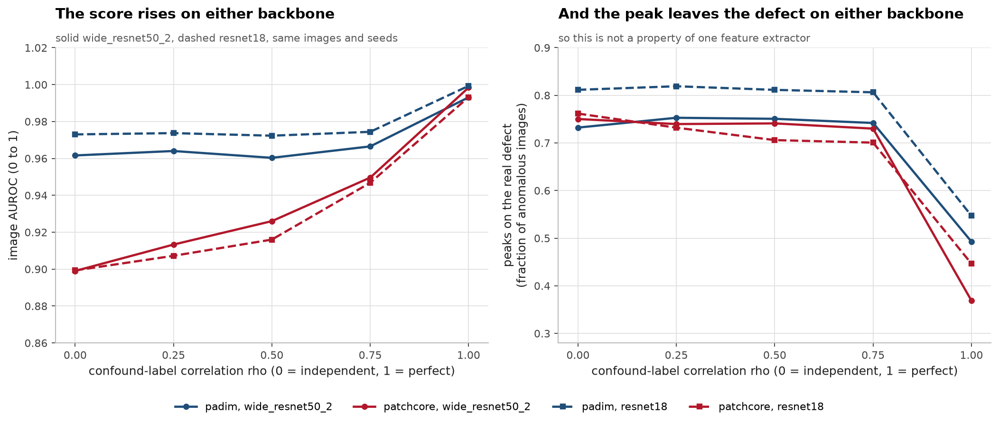

# SpuriousAD, a planted-confound benchmark that refutes its own premise

> Update: the synthetic result now also shows up on real MVTec images, with two
> detector families and two backbones (see [External validity](#5-external-validity)).
> When I pin the confound rate in the training set, CAR at perfect label
> correlation drops by half. So what drives it is the mark being absent from
> the training set. The detector isn't taking a shortcut through the label.

[](https://github.com/aghasalim/spurious-ad/actions/workflows/ci.yml)
[](https://www.python.org/)
[](LICENSE)
[](https://doi.org/10.5281/zenodo.23003682)

This is a controlled anomaly detection dataset. Every anomalous image has a real
defect and, somewhere else in the image, a spurious mark that correlates with
the label. I also wrote a metric that checks whether a detector's heatmap lands
on the defect or on the mark.

I built it to show that an unsupervised detector can get a perfect AUROC while
looking at the wrong region. It turned out that it doesn't, and most of this
README is about figuring out why.

---


---

## Abstract

If you want a controlled Clever Hans benchmark for unsupervised anomaly
detection, the obvious way is to plant an artefact that correlates with the
defect label and check whether the detector's heatmap moves onto it. I built
that benchmark and got a big effect with it. Then I found out the effect
wasn't what I thought it was.

When I make the planted confound stronger, image AUROC rises to 0.993 (PaDiM) and 0.998 (PatchCore).
At the same time, the share of heatmap peaks on the real defect falls from
about 0.75 to 0.49 and 0.37. Reproducible, too. I got it in every category and
after swapping the backbone.

The ablation showed my reading was wrong. Making the confound stronger changes
two things together. The artefact starts predicting the label, and it also
disappears from the training set, which only has normal images. Pinning the training confound rate at 0.465 separates
the two. With the rate pinned the collapse goes away completely, even at the
strength where the artefact predicts the label perfectly. Looking back it makes
sense. An unsupervised detector never sees a label, so it can't take a label
shortcut. It reacts to the artefact being out of distribution, and you could
argue that flagging that is the right thing to do.

So my main result is a negative one about method. The obvious way to build
this gives a real, reproducible, 4.2x effect, and that effect has nothing to do
with what the benchmark is supposed to measure.

What's in the repo:

- A planted-confound benchmark with a confound attribution ratio and a random
  attribution baseline.
- An ablation that pins the training rate, which removes the effect.
- External validity checks on MVTec categories, with two detectors and two
  backbones.
- A negative result about how not to build this kind of benchmark.

---

## 1. The headline

Here I sweep the correlation ρ between the confound and the label from 0 to 1,
with three seeds and a PatchCore-style detector trained only on normal images
(`make sweep`).

| ρ | image AUROC | CAR | CAR random control | peak on defect |
|---|---|---|---|---|
| 0.00 | **1.000** | 0.133 | 0.621 | 93.2% |
| 0.25 | **1.000** | 0.143 | 0.599 | 91.1% |
| 0.50 | **1.000** | 0.144 | 0.588 | 97.4% |
| 0.75 | **1.000** | 0.187 | 0.607 | 93.9% |
| 1.00 | **1.000** | **0.560** | 0.610 | 80.8% |

AUROC is 1.000 at every level. So the metric everyone reports can't tell you
whether a spurious mark is driving the score. That part of my hypothesis held up
fully.

CAR (Confound Attribution Ratio) is the share of the heat that sits on the mark
instead of the defect. It rises 4.2× here. At first that looked like the collapse I expected, but
it wasn't.

- CAR at ρ=1 is **0.560 against a random-heatmap control of 0.610**. The detector
  never starts looking for the confound. It just drifts towards what uniform
  noise would give, and that level depends on how big the two regions are
  compared to each other.
- The hottest single pixel still lands on the real defect **80.8%** of the time.





## 2. Then the ablation killed the premise outright
When rho goes up, the mark predicts the label better, and it also shows up less
in the training set (which only has normal images). Pinning the training
confound rate at 0.465 holds that second part fixed while rho changes. With it
pinned, CAR at rho=1 is 0.130, against 0.560 when the rate is left free and 0.133
at rho=0. The label correlation adds nothing, so the whole 4.2x effect was the
mark going missing from training.





*Each detector moves from rho 0 to rho 1, plotted as AUROC against peak on defect. In the solid lines the mark is allowed to drop out of the normal-only training set. The dashed lines pin that rate. Only the solid lines collapse.*

Worked through in [notes/METHODS.md](notes/METHODS.md#2-then-the-ablation-killed-the-premise-outright).
### What this does and does not say about prior work

This doesn't contradict [Kauffmann et al., *The Clever Hans Effect in Unsupervised
Learning*](https://arxiv.org/abs/2408.08041). They audit trained models on real
data after the fact, and they find Clever Hans effects that come from inductive
bias in how the models learn. That's a different mechanism from label
correlation, and I didn't test it here. My result is narrower. If you try to
build a controlled version of their setting the obvious way, you don't get the
effect they describe. You get an out-of-distribution artefact.

I'm also not criticising [AUPIMO](https://arxiv.org/abs/2401.01984). Its X-axis
already penalises false positives on normal images. The difference with CAR is
that CAR knows about one specific competing region. That's what lets you measure
"the heat went *there* instead" in the first place.

---

## 3. The metric
``` CAR = mass(confound) / (mass(defect) + mass(confound)) ``` over a normalised heatmap, on anomalous images that carry a confound.

A value of 0 means all the heat is on the real defect, and 1 means all of it is
on the spurious mark. A random heatmap doesn't score 0 though. It scores about
0.61 here, because the floor depends on how big the two regions are. So I always
compare CAR against that random control. Most of the heat actually lands in
neither region. The background share runs 0.84 to 0.90 across the sweep, and I
report it so it's out in the open.



Worked through in [notes/METHODS.md](notes/METHODS.md#3-the-metric).

## 4. Running it

```bash
make setup && make test
```

There are 17 tests. They cover the generator, the metric and the MVTec loader,
so they test my measuring tools and leave the model alone. Separate
implementations in `verify/` recompute every table in `reports/` from the raw
JSON of each run, and CI fails if any of them disagree.

```bash
make sweep && make mechanism
```

Each one takes a few minutes on CPU or Apple MPS. You don't need to download a
dataset. The data is generated, and that's how I get exact ground truth for
both regions.

---

## 5. External validity
On synthetic data, label correlation wasn't what drove the confound attribution. CAR went up because the mark became *out of distribution* for a training set with only normal images. The detector can't learn a label shortcut anyway, since it never sees labels.
Since that's a claim about mechanism, I wanted to check it on real images. `make
real-mechanism` plants the same confound in five MVTec AD categories and repeats
the pin there. At rho=1.0 the pin takes PatchCore CAR from 0.415 to 0.189 and
PaDiM from 0.387 to 0.201 against a null of 0.430, and with the pin, PatchCore's
hottest pixel lands on the real defect 74.8% of the time instead of 36.9%. I
also ran a resnet18 sweep without any pin, which supports this from the other
side. There, CAR climbs 0.21 to 0.39 across rho and never reaches its 0.43 null.




Worked through in [notes/METHODS.md](notes/METHODS.md#5-external-validity).

### The pin effect under a paired test

At first I only reported the pin as a difference between two means. But the
design is paired. Every run with the pin on has a matching run with the pin off,
with the same category, seed and detector. So I took the 15 paired differences
at rho=1 and went through all 2^15 sign flips, instead of assuming the
differences are normal. For PatchCore the mean is +0.2254, with t 4.47 and exact
p 4.883e-04. For PaDiM the mean is +0.1859, with t 4.82 and exact p
4.883e-04. That p is the smallest this data can give, because three of the
fifteen pairs differ by exactly zero.

Since the five MVTec categories are what I actually care about, I think it's
fairer to resample whole categories than single runs. Doing that puts the
PatchCore effect at [0.0803, 0.4014] and PaDiM at [0.0714, 0.3274]. I computed
the interval twice. Once I sampled it 20,000 times, and once I went through all
5^5 = 3,125 possible category resamples. Both ways agree to four decimals on all
four endpoints.

I also ran a control. At rho=0 the natural training confound rate is already
the same as the pinned rate, so pinning changes nothing there. Every paired
difference is exactly zero, with exact p 1.000. I wanted to see the test come
back null when it should.
## 6. Limitations

- Most of the work is on synthetic textures, and MVTec is the outside check. The
  mechanism holds on real images (see above), but the synthetic CAR values in the
  headline table depend on my generator. I'd expect the ordering and the
  mechanism to carry over. I wouldn't expect the exact numbers to.
- The resnet18 part is only a sweep. I didn't run the pinned ablation with it, so
  it supports the mechanism claim but doesn't prove it by itself.
- I used random subsampling for the memory bank instead of greedy coreset
  selection. Greedy k-center is mainly about making PatchCore faster, and it
  doesn't change what the memory represents.
- My result is negative. I don't show a real unsupervised Clever Hans effect
  anywhere here. I only show that this way of building the benchmark doesn't
  produce one.

## 7. Licence


MIT, see [LICENSE](LICENSE).

## References

The two detector papers, the dataset I replicated on, and the paper that names
the failure mode I was trying to plant.

- **Roth, Pemula, Zepeda, Schölkopf, Brox, Gehler. Towards Total Recall in Industrial Anomaly Detection. CVPR 2022.** [arXiv:2106.08265](https://arxiv.org/abs/2106.08265) PatchCore.
- **Defard, Setkov, Loesch, Audigier. PaDiM: a Patch Distribution Modeling Framework. ICPR 2021.** [arXiv:2011.08785](https://arxiv.org/abs/2011.08785) PaDiM.
- **Bergmann, Fauser, Sattlegger, Steger. MVTec AD. CVPR 2019.** the real image dataset the planted confound is replicated on.
- **Geirhos, Jacobsen, Michaelis et al. Shortcut Learning in Deep Neural Networks. Nature Machine Intelligence 2, 2020.** [arXiv:2004.07780](https://arxiv.org/abs/2004.07780) the failure mode this benchmark was built to plant deliberately.
